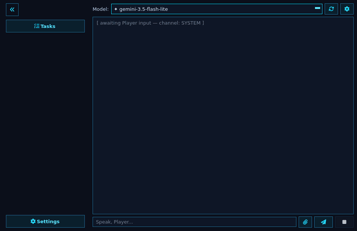
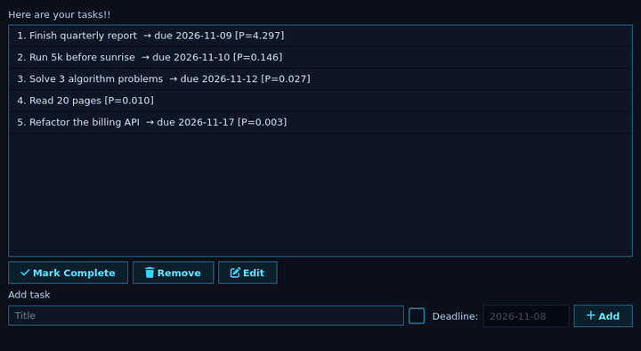
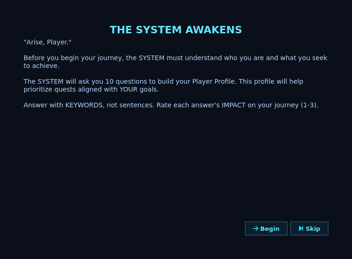
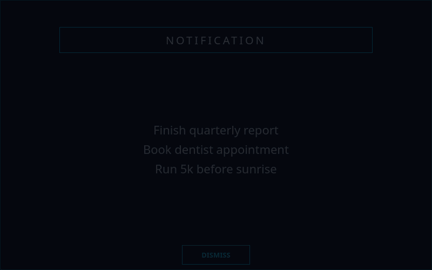
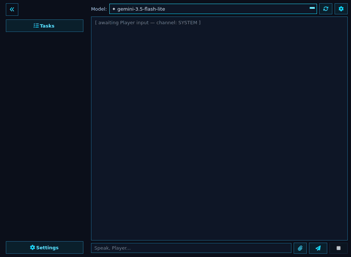

# SL — The SYSTEM

> _"Arise, Player."_

SL is a personal progression system inspired by Solo Leveling. You define your daily quests, and the SYSTEM keeps you on track from your desktop.

## Preview

<table>
  <tr>
    <td align="center"><br/><em>Main menu</em></td>
    <td align="center"><br/><em>Task manager</em></td>
    <td align="center"><br/><em>Onboarding wizard</em></td>
  </tr>
  <tr>
    <td align="center"><br/><em>Chat</em></td>
    <td align="center"><br/><em>System notification</em></td>
    <td align="center"><br/><em>Settings</em></td>
  </tr>
</table>

## Features

- **Persona Builder** — An optional 10-step onboarding process that builds your Player Profile from your real-world ambitions. Edit it any time from Settings.
- **Task Management** — Add, edit, complete, and drag to reorder quests with deadlines. Your reordering also trains the ranking.
- **Priority Engine** — Context-aware scoring (PRESSURE / GROWTH / RECOVERY) of what to work on next.
- **NLP Vectorizer** — spaCy-powered persona vectors built from your responses and task history, with temporal decay.
- **AI Chatbot** — Talk to the System, an AI mentor with task-aware tools, streaming replies, and live markdown. It asks before adding a quest you didn't explicitly request.
- **Your Choice of Model** — Google Gemini, Ollama, LM Studio, OpenRouter, Groq, Together AI, or any OpenAI-compatible endpoint. Switch models from the chat panel.
- **Document Attachments** — Attach or drag in a PDF, DOCX, HTML, or text file and review the tasks found in it before they're added. Scanned PDFs are read with OCR.
- **Google Tasks Sync** — Import your Google Tasks as quests. Opt-in from Settings.
- **Native Notifications** — Desktop alerts styled like the System, with custom notification sounds.
- **Background Reminder** — An hourly notifier that keeps you on track, with its own on/off switch.
- **Cross-Platform Autostart** — Register the notifier on Linux, Windows, or macOS.
- **Themes** — Follow the system’s light/dark appearance, choose Light, pick a darker near-black Dark palette, or generate colors from your wallpaper.
- **Tabbed Settings and Collapsible Sidebar** — All options live in one Settings window, and `Ctrl+Shift+S` shrinks the sidebar to a rail of icons.
- **System Tray** — Optionally keep the app running in the tray when you close the window.
- **Auto Update** — Optionally install new releases at launch, verified against their published SHA-256 checksums.
- **Secure Key Storage** — API keys and Google tokens are kept in your system keyring, or an encrypted file if none is available.

## Installation

### Option 1: AppImage (Linux — Recommended)

Download the latest `system-sl-<version>-x86_64.AppImage` from [GitHub Releases](https://github.com/sproutcake23/System-SL/releases).

```bash
chmod +x system-sl-*.AppImage
./system-sl-*.AppImage
```

**Desktop integration (choose one):**

| Method | Command | Notes |
|--------|---------|-------|
| **Built-in (Recommended)** | `./system-sl-*.AppImage --install-desktop` | Moves the AppImage to `~/Applications` and adds a menu entry, no extra tools |
| **AppImageLauncher** | Download from [GitHub](https://github.com/TheAssassin/AppImageLauncher/releases) | GUI tool, file manager integration, update management |
| **Gear Lever** | `flatpak install flathub it.mijorus.gearlever` | Modern AppImage manager, requires Flatpak |

Run the built-in `--install-desktop` once after downloading, or use **Settings → Install App** from inside the running AppImage:

```bash
chmod +x system-sl-*.AppImage
./system-sl-*.AppImage --install-desktop
```

### Option 2: Windows Installer

Download `system-sl-setup.exe` from [GitHub Releases](https://github.com/sproutcake23/System-SL/releases) and run it.

This creates:
- Start Menu entry
- Desktop shortcut
- Uninstaller in Settings → Apps

### Option 3: Portable EXE (Windows/Linux)

Download `system-sl-windows.zip` (Windows) or `system-sl-linux.tar.xz` (Linux) from [GitHub Releases](https://github.com/sproutcake23/System-SL/releases).

Extract and run `system-sl.exe` / `system-sl` directly.

Every release also publishes `SHA256SUMS.txt` so you can verify your download.

### Option 4: From Source (Development)

Requirements: Python >= 3.11 and < 3.14, and [uv](https://github.com/astral-sh/uv).

```bash
git clone https://github.com/sproutcake23/System-SL.git
cd System-SL
uv sync
```

Launch the desktop app:
```bash
uv run system-sl
```

Run the background notifier:
```bash
uv run system-sl --bg
```

Build a standalone executable:
```bash
uv run build-sl
```

On first launch, the app asks for your chatbot provider, model, and API key.

To read scanned PDFs from source, install `tesseract` and `poppler` on your system. Release builds include them.

Source installs don't include the app's Google OAuth client. To use Google Tasks Sync from source, set up your own; see [Google Tasks Sync](https://github.com/sproutcake23/System-SL/wiki/Google-Tasks-Sync#using-your-own-oauth-client).

## Documentation

Full documentation lives in the wiki:

- [Installation](https://github.com/sproutcake23/System-SL/wiki/Installation)
- [Features](https://github.com/sproutcake23/System-SL/wiki/Features)
- [Google Tasks Sync](https://github.com/sproutcake23/System-SL/wiki/Google-Tasks-Sync)
- [CLI Usage](https://github.com/sproutcake23/System-SL/wiki/CLI-Usage)
- [Background Service](https://github.com/sproutcake23/System-SL/wiki/Background-Service)
- [Building and Releasing](https://github.com/sproutcake23/System-SL/wiki/Building-and-Releasing)

## Contributing

See [CONTRIBUTING.md](CONTRIBUTING.md).

## License

GPL-3.0-or-later — see [LICENSE](LICENSE) for details.