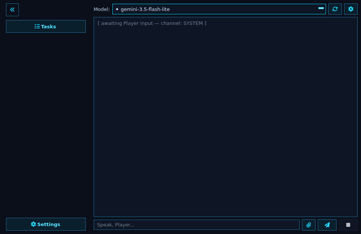
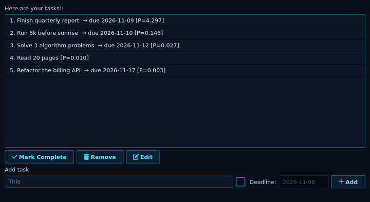
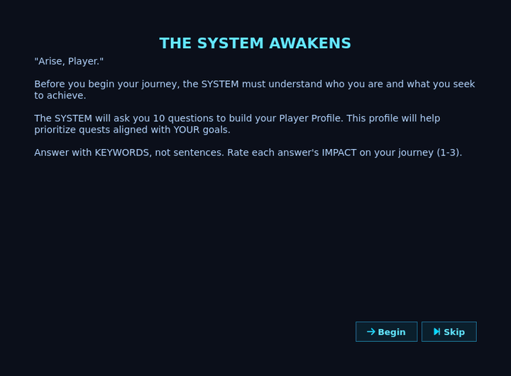
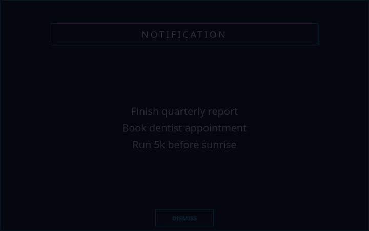
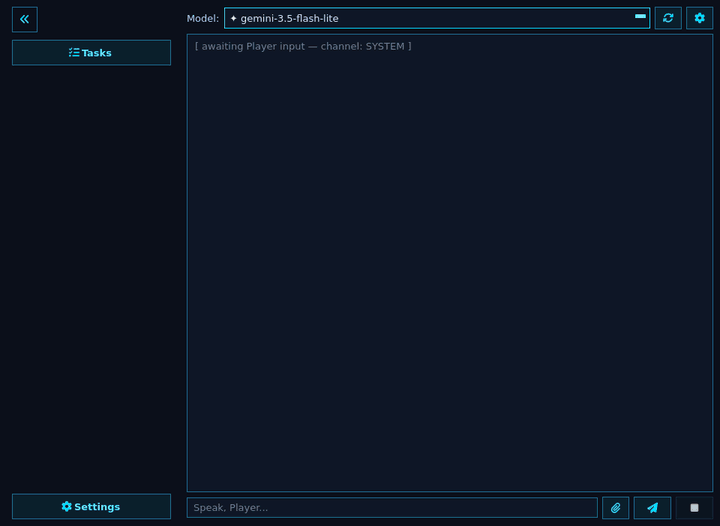

# SL — The SYSTEM

> _"Arise, Player."_

SL is a personal progression system inspired by Solo Leveling. You define your daily quests, and the SYSTEM keeps you on track from your desktop.

## Screenshots

## Pages

- [Installation](Installation)
- [Features](Features)
- [Google Tasks Sync](Google-Tasks-Sync)
- [Command-Line Flags](Command-Line-Flags)
- [Background Service](Background-Service)
- [Building and Releasing](Building-and-Releasing)
