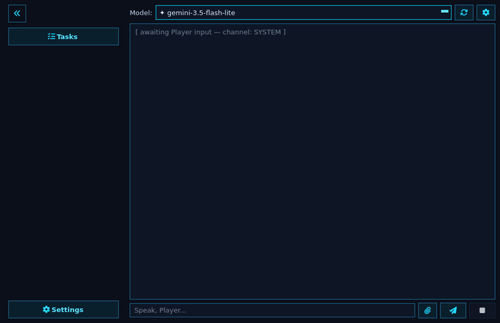
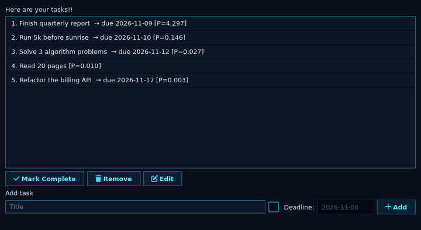
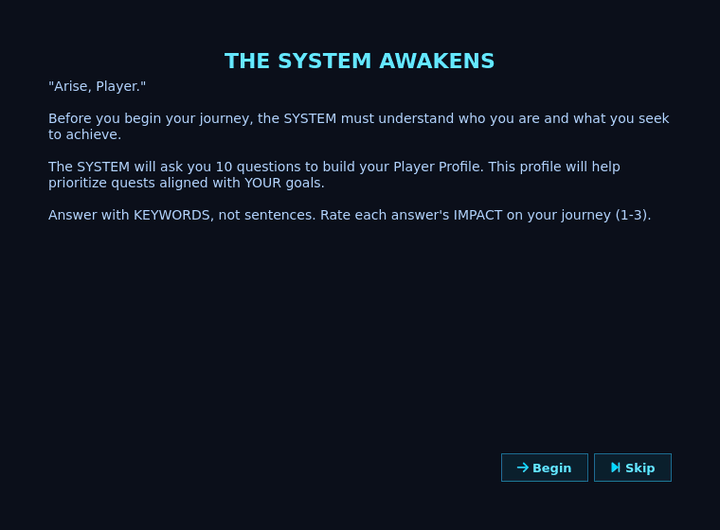
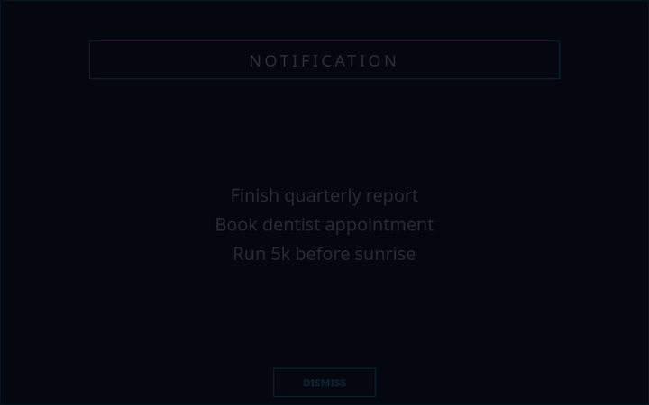
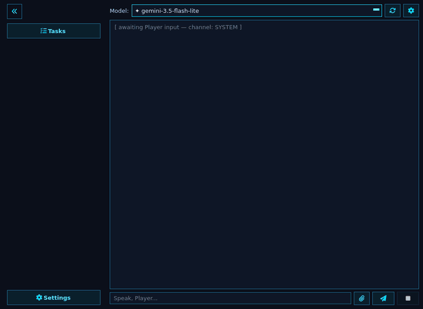

# SL — The SYSTEM

> _"Arise, Player."_

SL is a personal progression system inspired by Solo Leveling. You define your daily quests, and the SYSTEM keeps you on track from your desktop.

## Preview

<table>
  <tr>
    <td align="center"><br/><em>Main menu</em></td>
    <td align="center"><br/><em>Task manager</em></td>
    <td align="center"><br/><em>Onboarding wizard</em></td>
  </tr>
  <tr>
    <td align="center"><br/><em>Chat</em></td>
    <td align="center"><br/><em>System notification</em></td>
    <td align="center"><br/><em>Settings</em></td>
  </tr>
</table>

## Features

- **Persona Builder** — An optional 10-step onboarding process that builds your Player Profile from your real-world ambitions. Edit it any time from Settings.
- **Task Management** — Add, edit, complete, and drag to reorder quests with deadlines. Your reordering is saved and applied to the ranking.
- **Priority Engine** — Context-aware scoring (PRESSURE / GROWTH / RECOVERY) of what to work on next.
- **NLP Vectorizer** — spaCy-powered persona vectors built from your responses and task history, with temporal decay.
- **AI Chatbot** — Talk to the System, an AI mentor with task-aware tools, streaming replies, and live markdown. It asks before adding a quest you didn't explicitly request.
- **Your Choice of Model** — Google Gemini, Ollama, LM Studio, OpenRouter, Groq, Together AI, or any OpenAI-compatible endpoint. Switch models from the chat panel.
- **Document Attachments** — Attach or drag in a PDF, DOCX, HTML, or text file and review the tasks found in it before they're added. Scanned PDFs are read with OCR.
- **Google Tasks Sync** — Import your Google Tasks as quests. Opt-in from Settings.
- **Native Notifications** — Desktop alerts styled like the System, with custom notification sounds.
- **Background Reminder** — An hourly notifier that keeps you on track, with its own on/off switch.
- **Cross-Platform Autostart** — Register the notifier on Linux, Windows, or macOS.
- **Themes** — Follow the system’s light/dark appearance, choose Light, pick a darker near-black Dark palette, or generate colors from your wallpaper.
- **Tabbed Settings and Collapsible Sidebar** — All options live in one Settings window, and `Ctrl+Shift+S` shrinks the sidebar to a rail of icons.
- **System Tray** — Optionally keep the app running in the tray when you close the window.
- **Auto Update** — Optionally install new releases at launch, verified against their published SHA-256 checksums.
- **Secure Key Storage** — API keys and Google tokens are kept in your system keyring, or an encrypted file if none is available.

## Quick Start

Requirements: Python >= 3.11 and < 3.14, and [uv](https://github.com/astral-sh/uv).

```bash
git clone https://github.com/sproutcake23/System-SL.git
cd System-SL
uv sync
```

Launch the desktop app:

```bash
uv run system-sl
```

Run the background notifier:

```bash
uv run system-sl --bg
```

Build a standalone executable:

```bash
uv run build-sl
```

## Other pages

- [Installation](Installation)
- [Features](Features)
- [Google Tasks Sync](Google-Tasks-Sync)
- [CLI Usage](CLI-Usage)
- [Background Service](Background-Service)
- [Building and Releasing](Building-and-Releasing)
